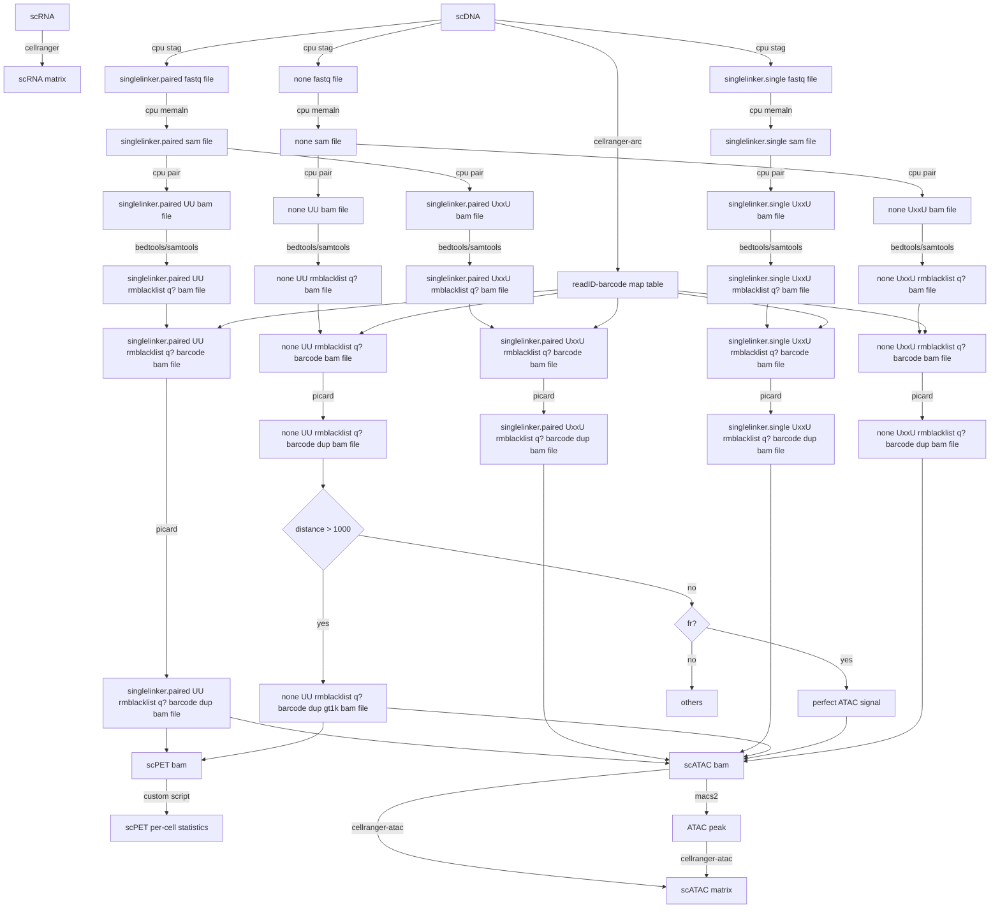

# ChAIR-PIPE
Program for ChAIR data analysis




# REQUIREMENT
```
ChIAPET-pipeline (https://github.com/TheJacksonLaboratory/ChIA-PIPE)
MACS v2.2.7.1
BEDTools v2.27.1
SAMTools v1.9
DeepTools v3.5.1
Juicer tools 1.22.01 
HiCRep Python version https://github.com/dejunlin/hicrep
HiCExplorer v3.5
hisat v2.1.0 
htseq-count v0.13.5
R 4.4 or later recommended
Seurat 4.3.0
Signac 1.10.0
harmony 0.1.1
DoubletFinder 2.0.3
cellranger 6.0.0
cellranger-arc 2.0.2
cellranger-atac 2.1.0
dip-c: https://github.com/tanlongzhi/dip-c
Nucdynamic: https://github.com/tjs23/nuc_dynamics
CrossMap v0.6.1
monocle3 1.3.5
bwa 0.7.17
bcftools 1.17
ucsc_kentUtils: https://hgdownload.soe.ucsc.edu/admin/exe/linux.x86_64/
singularity 3.8.5-2.el7
Picard
BandNorm
Dip-c
Nuc
CtG

Python
R
Perl

Slurm
```
Some tools can be run using Singularity images. Set their command prefixes in the configuration.
```
cellranger_6.0.0.sif
cpu0.0.1a-r2.sumner.sif
GATK_latest.sif
juicer_1.22.01.sif
```
```
cp cellranger_6.0.0.sif cpu0.0.1a-r2.sumner.sif GATK_latest.sif juicer_1.22.01.sif singularity
```

## Run the complete analysis

Use Linux with SLURM. Copy `config/example.mm10.env`, set the reference paths, software commands, output directory and SLURM resources, then run the entry point. The configuration lists the analysis defaults and accepts installed tools or container command prefixes.

Create a tab-separated table with one DNA FASTQ prefix and one RNA FASTQ prefix per row. Each prefix ends before `_S..._L..._R...`; use absolute paths. DNA uses R1/R3 for genomic reads and R2 for the barcode.

```text
/data/fastq/MOSCCA0020-15872_SI-NA-D6	/data/fastq/MOSCCA0015-15878_GTAACATGCG-AGGTAACACT
```

```bash
bash submit_cpu10x_for_scChiatac.mm10.nobl.sh samples.tsv config/my_run.env
```

The entry point submits ARC barcode assignment, independent RNA counting, CPU DNA processing, fragment and peak generation, ATAC reanalysis, PET statistics, and downstream cell analysis with success dependencies between stages. Outputs are written below `OUTPUT_DIR/<DNA-prefix-basename>/`.

| Output | Relative location |
| --- | --- |
| RNA matrix | `10xGEX/outs/raw_feature_bc_matrix.h5` |
| ATAC matrix from the pipeline's fragments and peaks | `10xATAC/outs/raw_peak_bc_matrix.h5` |
| Fragment intervals and index | `bulkChiatac/<sample>.fragments.tsv.gz` and `.tbi` |
| PET statistics | `bulkChiatac/<sample>.hq.CB.nr.bedpe.stat` |
| Final Seurat object | `CallCell/data/<sample>.final.rds` |
| QC metadata including RNA doublet labels | `CallCell/data/<sample>.metadata.txt` |
| Recorded analysis input paths | `CallCell/data/input_paths.tsv` |

Fragment export uses the author's `classPET.py` and `bam2fragment.py`: short inward-facing pairs use the paired branch; PET and other alignments use the single-end branch.

`codes/callcell_xingyu.R` applies `PET_intragt1000 > 50` and intersects RNA, ATAC and PET barcodes. It retains the author's RNA doublet filtering, RNA/ATAC clustering and WNN workflow through `codes/function.R`. QC thresholds and reduction settings are configured in the environment file.

For existing matrices, the same downstream entry accepts RNA/ATAC H5 files or Matrix Market directories.

```bash
Rscript --vanilla codes/callcell_xingyu.R SAMPLE RNA_MATRIX ATAC_MATRIX FRAGMENTS PET_STATS OUTPUT_DIR mm10
```

The fragment input requires its `.tbi` index. For hg38, set the corresponding references, `genome=hg38` and `gmac=hs` in the configuration. Downstream R requires the matching EnsDb and BSgenome packages, plus the Seurat, SeuratObject, Signac, DoubletFinder, harmony, dplyr, magrittr, ggplot2, patchwork, stringr, reshape2, matrixStats and data.table packages used by the supplied scripts. Python requires pysam. `bamCoverage` generates the RPKM tracks.

The completed MOSCCA0020 downstream validation used R 4.4.1, Seurat 5.3.0, SeuratObject 5.1.0, Signac 1.14.0 and DoubletFinder 2.0.4. The software list above is retained from the original README; this paragraph records the tested downstream environment. The run records its actual versions in `CallCell/data/sessionInfo.txt`.

## Using the original preparation examples

The original data-download and file-naming examples are retained below. Put the reference and genome settings from step 4 into your configuration file, including the matching `ATACref` and blacklist. Select that file before running the original launch commands:

```bash
export CHAIR_CONFIG=/absolute/path/to/config/my_run.env
```

For K562, use `genome=hg38`, `gmac=hs` and matching human references. Run all processing commands through the same entry point shown above.

# USAGE
```
1. Download data from CNCB (https://www.cncb.ac.cn/)
2. Changing the file name to match cellranger's requirements
3. download the reference index from 10xgenomics (for cellranger/cellranger-arc/cellranger-atac)
4. bash submit_cpu10x_for_scChiatac.mm10.nobl.sh SCG0192_GT22-15872_SI-NA-D6.fastq.prefix > SCG0192_GT22-15872_SI-NA-D6.fastq.prefix.log 2>SCG0192_GT22-15872_SI-NA-D6.fastq.prefix.log.run.sh
```

# EXAMPLE
```
step1-2:
wget https://download.cncb.ac.cn/gsa-human/HRA007068/HRR1686121/HRR1686121.tar.gz # DNA
wget https://download.cncb.ac.cn/gsa-human/HRA007068/HRR1686122/HRR1686122.tar.gz # RNA
tar zxf HRR1686121.tar.gz 
tar zxf HRR1686122.tar.gz

mv K562_Rep1.DNA.R1_001.fastq.gz SCG0074-15872_SI-NA-D6_S5_L003_R1_001.fastq.gz
mv K562_Rep1.DNA.R2_001.fastq.gz SCG0074-15872_SI-NA-D6_S5_L003_R2_001.fastq.gz
mv K562_Rep1.DNA.R3_001.fastq.gz SCG0074-15872_SI-NA-D6_S5_L003_R3_001.fastq.gz
mv K562_Rep1.RNA.R1_001.fastq.gz SCG0081-15878_GTAACATGCG-AGGTAACACT_S1_L001_R1_001.fastq.gz
mv K562_Rep1.RNA.R2_001.fastq.gz SCG0081-15878_GTAACATGCG-AGGTAACACT_S1_L001_R2_001.fastq.gz

step3:
# https://www.10xgenomics.com/support/software/cell-ranger/downloads#reference-downloads
wget https://cf.10xgenomics.com/supp/cell-exp/refdata-gex-GRCh38-2024-A.tar.gz
tar zxf refdata-gex-GRCh38-2024-A.tar.gz

# https://www.10xgenomics.com/support/software/cell-ranger-arc/downloads#reference-downloads
wget https://cf.10xgenomics.com/supp/cell-arc/refdata-cellranger-arc-GRCh38-2024-A.tar.gz
tar zxf refdata-cellranger-arc-GRCh38-2024-A.tar.gz

step4:
# change the parameter in submit_cpu10x_for_scChiatac.mm10.nobl.sh script：
export genome=hg38 # hg38
export ARCref=$abspath/refdata-cellranger-arc-GRCh38-2024-A # arc genome ref
export GEXref=$abspath/refdata-gex-GRCh38-2024-A # gex genome ref
fasta=hg38.fa # with hg38 bwa index

# edit a input file: k562.SCG0074.fastq.prefix
$abspath/SCG0074-15872_SI-NA-D6	$abspath/SCG0081-15878_GTAACATGCG-AGGTAACACT # No blank line breaks

bash submit_cpu10x_for_scChiatac.mm10.nobl.sh k562.SCG0074.fastq.prefix > k562.SCG0074.fastq.prefix.log 2>k562.SCG0074.fastq.prefix.log.run.sh
```

## Visualize results with ChAIR-Viewer

Prepare the following ChAIR-PIPE outputs for the Viewer. Coverage tracks use RPKM-normalized bedGraph files.

| Viewer input | ChAIR-PIPE source | Preparation |
| --- | --- | --- |
| RNA barcode intervals | `10xGEX/outs/possorted_genome_bam.bam` | Export five columns `chrom, start, end, barcode, count`. |
| ATAC barcode intervals | `bulkChiatac/<sample>.fragments.tsv.gz` | Use the five-column interval table. |
| ATAC peaks | `bulkChiatac/<sample>.peak` | Three columns `chrom, start, end`. |
| Ensemble RNA coverage | `<sample>.GEX.RPKM.bedgraph.gz` | Four columns `chrom, start, end, value`. |
| Ensemble ATAC coverage | `bulkChiatac/<sample>.ATAC.RPKM.bedgraph.gz` | Four columns `chrom, start, end, value`. |
| Single-cell PET | `bulkChiatac/*.UU.F2048.CB.nr.bedpe.gz` | Separate the barcode prefix from the read name to prepare the Viewer's eleven-column PET table. |
| Chromatin loops | CPU/ChiaSig loop-calling outputs | Prepare the seven-column or ten-column loop table required by the selected track. |

Use matching genome assemblies and complete barcodes across tracks. Prepare gene annotations and bulk comparison tracks separately. For a selected cell population, prepare its barcode tables and RPKM coverage from the same cells. The Viewer README lists the complete file set and naming conventions used by `readInfo.R`. Organize those files with `readInfo.R`, then load and plot the RData with `loadData()` and `run()`. [ChAIR-Viewer inputs and usage](https://github.com/Chang-An2002/ChAIR-Viewer)

# CONTACT
黄星宇 (Xingyu Huang, xingyu.huang@zju.edu.cn/huang182@live.cn)
