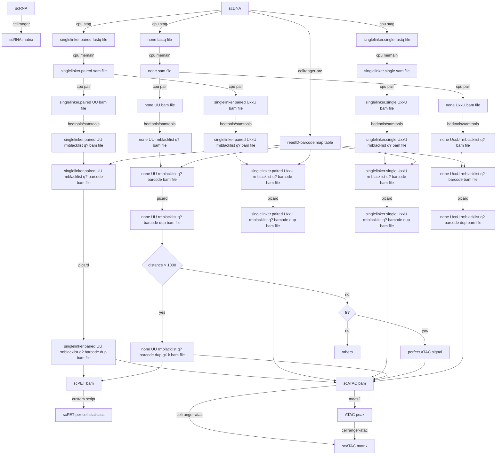

# ChAIR-PIPE
Program for ChAIR data analysis




Blacklist filtering for ATAC outputs is applied after merging the DNA branches shown above. PET BEDPE for per-cell statistics and visualization is exported before this merge. CPU/ChiaSig loop candidates undergo a separate blacklist filter.

## Installation

Use Linux with SLURM, Singularity/Apptainer and Conda or Mamba.

```bash
git clone https://github.com/Chang-An2002/ChAIR-PIPE.git
cd ChAIR-PIPE
mkdir -p singularity
singularity build singularity/scMAV.sif docker://fengchuiguo1994/scmav:v1
wget -O singularity/juicer_tools_1.22.01.jar https://s3.amazonaws.com/hicfiles.tc4ga.com/public/juicer/juicer_tools_1.22.01.jar
echo '5bd863e1fbc4573de09469e0adc5ab586e2b75b14dd718465e14dc299d7243a0  singularity/juicer_tools_1.22.01.jar' | sha256sum -c -
```

Keep `juicer_tools_1.22.01.jar` beside `scMAV.sif`. The configuration loads Juicer Tools 1.22.01 from this file using the Java runtime in the image. The upstream tools are selected through command prefixes in the configuration. To inspect the supplied tools:

```bash
singularity exec singularity/scMAV.sif cellranger --version
singularity exec singularity/scMAV.sif cpu
singularity exec singularity/scMAV.sif gatk --version
singularity exec \
  --bind "$PWD/singularity/juicer_tools_1.22.01.jar:/opt/software/juicer_tools.1.8.9_jcuda.0.8.jar:ro" \
  singularity/scMAV.sif juicer_tools -V
```

Prepare the R environment for downstream analysis and Viewer plotting:

```bash
conda create -y -n chair-r -c conda-forge r-base=4.4.1 r-remotes r-biocmanager \
  c-compiler cxx-compiler fortran-compiler cmake make pkg-config libxml2 libcurl openssl hdf5 gsl
conda run --no-capture-output -n chair-r Rscript config/install_r_packages.R mm10
# For human data, use hg38 as the last argument.
```

A CRAN mirror can be selected with the `CHAIR_CRAN_MIRROR` environment variable.

The recommended software versions for downstream analysis are Seurat 5.3.0, R ≥ 4.1.0, Matrix ≥ 1.6-4, SeuratObject ≥ 5.0.2, Signac ≥ 1.12.0 and DoubletFinder 2.0.4. Python input preparation uses pysam and bx-python.

## Reference files

Download matching GEX and ARC references from [10x Genomics](https://www.10xgenomics.com/support/software/cell-ranger-arc/downloads#reference-downloads). The ARC 2.0 reference is also used by `cellranger-atac reanalyze`. For example, for hg38:

```bash
mkdir -p /data/references
cd /data/references
wget https://cf.10xgenomics.com/supp/cell-exp/refdata-gex-GRCh38-2020-A.tar.gz
wget https://cf.10xgenomics.com/supp/cell-arc/refdata-cellranger-arc-GRCh38-2020-A-2.0.0.tar.gz
tar -xzf refdata-gex-GRCh38-2020-A.tar.gz
tar -xzf refdata-cellranger-arc-GRCh38-2020-A-2.0.0.tar.gz
wget https://raw.githubusercontent.com/Boyle-Lab/Blacklist/master/lists/hg38-blacklist.v2.bed.gz
gzip -dk hg38-blacklist.v2.bed.gz
singularity exec /absolute/path/to/scMAV.sif bwa index \
  refdata-cellranger-arc-GRCh38-2020-A-2.0.0/fasta/genome.fa
```

For mm10, select the mm10 GEX/ARC references and mm10 blacklist. Set `fasta` to the indexed genome FASTA. Genome assembly and chromosome names must match across these inputs.

## Prepare FASTQ inputs

Start with demultiplexed lane-level FASTQ files from the PET, ATAC and RNA libraries of the same sample. Check that each DNA lane has R1/R2/R3 and each RNA lane has R1/R2. DNA R1/R3 contain genomic reads and R2 contains the barcode. Put the files under `INPATH/PETSAMPLEID/`, `INPATH/ATACSAMPLEID/` and `INPATH/RNASAMPLEID/`; subdirectories are also searched. Both `*_R1.fastq.gz` and `*_R1_001.fastq.gz` names, with matching R2/R3 names, are supported.

Run the protocol's merge command after setting the input root and the sample's output directory:

```bash
cd /absolute/path/to/ChAIR-PIPE
export INPATH=/data/raw_fastq
export OUTPATH=/data/merged/SAMPLEID
bash codes/merge_fastq.sh PETSAMPLEID,ATACSAMPLEID,RNASAMPLEID,SAMPLEID
```

The script combines PET and ATAC reads across lanes into DNA R1/R2/R3, separately combines RNA reads, and truncates RNA R1 sequence and quality to 28 bp and RNA R2 sequence and quality to 90 bp. It creates `OUTPATH` if needed and requires that its five output FASTQ filenames do not already exist. The output prefixes are `$OUTPATH/SAMPLEID` for DNA and `$OUTPATH/SAMPLEID_GTAACATGCG-AGGTAACACT` for RNA; the shared sample identifier links these two libraries in the input list.

Create the two-column `xxx.fastqlist` described in the protocol. Each row contains the absolute merged DNA FASTQ prefix first and the matched RNA FASTQ prefix second, separated by whitespace (a tab is recommended), with no header. The prefix ends before `_S..._L..._R...` and does not include `.fastq.gz`:

```bash
printf '%s\t%s\n' "$OUTPATH/SAMPLEID" "$OUTPATH/SAMPLEID_GTAACATGCG-AGGTAACACT" > xxx.fastqlist
```

For multiple samples, add one matched DNA/RNA pair per row. The merge script does not create this list, and the main submission script does not invoke the merge script. If the FASTQ files have already been merged and prepared, such as the K562 download below, use their existing prefixes directly in `xxx.fastqlist` and skip merging.


## Configure a run

Copy the supplied example to your own configuration file:

```bash
cd /absolute/path/to/ChAIR-PIPE
cp config/example.mm10.env config/my_run.env
```

Edit `config/my_run.env`:

| Setting | Value to supply |
| --- | --- |
| `genome`, `gmac` | `mm10`, `mm` for mouse; `hg38`, `hs` for human |
| `ARCref`, `GEXref`, `ATACref` | Extracted reference directories; `ATACref` can use the matching ARC 2.0 reference |
| `fasta`, `blacklist` | Indexed genome FASTA and uncompressed blacklist BED |
| `image`, `Rcmd` | Absolute scMAV image path and the Rscript command for the prepared R environment |
| `SINGULARITY_BIND` | Comma-separated base directories containing data, references and outputs |
| `OUTPUT_DIR` | Analysis output directory |
| `QUEUE`, `smallQUEUE`, `highpart` | SLURM partition names |
| Thread and memory settings | Resources available on your cluster |
| `addLinkerSeq` | DNA linker; the supplied K562/ChAIR example uses `-A ATAGGCGCTGGTTGCGTTGT` |

Use the two-column `xxx.fastqlist` prepared above as the pipeline input list.

## Run the analysis

```bash
bash submit_cpu10x_for_scChiatac.mm10.nobl.sh xxx.fastqlist config/my_run.env
```

The second argument supplies the run configuration. For the protocol's one-argument command, export `CHAIR_CONFIG=/absolute/path/to/ChAIR-PIPE/config/my_run.env` and omit the second argument.

The entry submits ARC barcode assignment, RNA counting, DNA alignment and deduplication, fragment/peak generation, ATAC reanalysis, PET statistics and downstream R analysis with SLURM success dependencies. Job scripts and logs are in `OUTPUT_DIR/<sample>/slurm/`.

| Output under `OUTPUT_DIR/<sample>/` | Contents |
| --- | --- |
| `10xGEX/outs/raw_feature_bc_matrix.h5` | RNA matrix |
| `10xATAC/outs/raw_peak_bc_matrix.h5` | ATAC matrix |
| `bulkChiatac/<sample>.fragments.tsv.gz` and `.tbi` | Five-column fragments and index |
| `bulkChiatac/<sample>.peak` | Three-column ATAC peaks |
| `bulkChiatac/<sample>.hq.CB.nr.bedpe.stat` | Eight per-barcode PET statistics |
| `CallCell/data/<sample>.QC.rds` | All QC-passed cells with doublet labels, pANN and RNA/ATAC reductions |
| `CallCell/data/<sample>.metadata.txt` | Complete QC metadata |
| `CallCell/data/<sample>.final.rds` | Singlet object with RNA/ATAC/WNN analysis |
| `CallCell/data/final_barcodes.txt` | Final singlet barcodes |
| `CallCell/*.pdf` and `CallCell/deepcluster/` | QC, doublet, clustering and marker plots |
| `CallCell/data/sessionInfo.txt` and `input_paths.tsv` | Software versions and analysis input paths |

`callcell.R` uses RNA/ATAC/PET barcode intersection and the configured QC thresholds. Defaults are RNA count ≥400, ATAC count ≥4,000, PET_intragt1000 ≥300, mitochondrial percentage <20 and ribosomal percentage <50. RNA uses `min.cells=5`, 3,000 HVGs, clustering resolution 0.8 and workflow seed 1234. DoubletFinder uses automatic pK selection, homotypic adjustment, expected rate 0.054, pN=0.25 and PCs 1:30. The ATAC reference settings are q0, LSI 2:30 and resolution 0.8. The objects retain chrY peaks and `blacklist_fraction` QC values. Parameters are set in the configuration and `codes/function.R`.

For existing matrices:

```bash
Rscript --vanilla codes/callcell.R SAMPLE RNA_MATRIX ATAC_MATRIX FRAGMENTS PET_STATS OUTPUT_DIR mm10
```

RNA/ATAC matrices may be H5 files or Matrix Market directories; fragments require their `.tbi` index.

## Prepare ChAIR-Viewer inputs

After analysis, run the supplied preparation script with the sample directory, Viewer input directory, reference GTF and run configuration. On SLURM, allocate memory using the `DOWNSTREAM_GB` setting:

```bash
source config/my_run.env
sbatch --partition="$QUEUE" --cpus-per-task=1 --mem="${DOWNSTREAM_GB}G" \
  --wrap="bash $PWD/codes/prepare_viewer_inputs.sh /data/results/SCG0074-15872_SI-NA-D6 /data/viewer/K562 /data/references/refdata-gex-GRCh38-2020-A/genes/genes.gtf $PWD/config/my_run.env"
```

The script exports RNA intervals using the author's alignment exporter, selects final-cell ATAC/PET records, separates PET barcodes from read names, prepares fixed-anchor loops with `bedpe2ipet.py` and `loopCallingGivenAnchor.py`, converts gene annotations and writes `inputs.tsv`. The two loop-preparation scripts are the author's existing implementations. Ensemble coverage uses the sample-level RPKM tracks generated by the pipeline.

| Prepared input | Columns/source |
| --- | --- |
| `RNA.intervals.tsv.gz`, `ATAC.intervals.tsv.gz` | `chrom, start, end, barcode, count` |
| `PET.bedpe.gz` | `chrom1, start1, end1, chrom2, start2, end2, barcode, readID, score, strand1, strand2` |
| `ATAC.peaks.bed` | `chrom, start, end` |
| `PET.loops.tsv.gz` | Coordinates of both anchors, count, anchor1 coverage, anchor2 coverage, VC_sqrt score |
| `genes.bed` | Eight-column gene/transcript annotation |
| RPKM paths in `inputs.tsv` | `<sample>.GEX.RPKM.bedgraph` and `bulkChiatac/<sample>.ATAC.RPKM.bedgraph.gz` |

Then follow [ChAIR-Viewer](https://github.com/Chang-An2002/ChAIR-Viewer/tree/main) to load `inputs.tsv` and plot a region.

## K562 FASTQ download and filenames

Run the following commands in your FASTQ directory, then use the K562 prefixes in `xxx.fastqlist` and the hg38 settings described above. These files are already prepared DNA/RNA inputs; skip `merge_fastq.sh` for this example.

```bash
wget https://download.cncb.ac.cn/gsa-human/HRA007068/HRR1686121/HRR1686121.tar.gz # DNA
wget https://download.cncb.ac.cn/gsa-human/HRA007068/HRR1686122/HRR1686122.tar.gz # RNA
tar zxf HRR1686121.tar.gz 
tar zxf HRR1686122.tar.gz

mv K562_Rep1.DNA.R1_001.fastq.gz SCG0074-15872_SI-NA-D6_S5_L003_R1_001.fastq.gz
mv K562_Rep1.DNA.R2_001.fastq.gz SCG0074-15872_SI-NA-D6_S5_L003_R2_001.fastq.gz
mv K562_Rep1.DNA.R3_001.fastq.gz SCG0074-15872_SI-NA-D6_S5_L003_R3_001.fastq.gz
mv K562_Rep1.RNA.R1_001.fastq.gz SCG0081-15878_GTAACATGCG-AGGTAACACT_S1_L001_R1_001.fastq.gz
mv K562_Rep1.RNA.R2_001.fastq.gz SCG0081-15878_GTAACATGCG-AGGTAACACT_S1_L001_R2_001.fastq.gz
```

<details>
<summary>Additional analysis software</summary>

The following software is used for extended analyses:

```text
ChIAPET-pipeline (https://github.com/TheJacksonLaboratory/ChIA-PIPE)
HiCRep Python version https://github.com/dejunlin/hicrep
HiCExplorer v3.5
hisat v2.1.0 
htseq-count v0.13.5
dip-c: https://github.com/tanlongzhi/dip-c
Nucdynamic: https://github.com/tjs23/nuc_dynamics
CrossMap v0.6.1
monocle3 1.3.5
bwa 0.7.17
bcftools 1.17
ucsc_kentUtils: https://hgdownload.soe.ucsc.edu/admin/exe/linux.x86_64/
Picard
BandNorm
Dip-c
Nuc
CtG


```
</details>

## Contact

黄星宇 (Xingyu Huang, xingyu.huang@zju.edu.cn/huang182@live.cn)  
齐堃锐 (Kunrui Qi, 12407081@zju.edu.cn)
